<p align="center">
  <picture>
    <source media="(prefers-color-scheme: dark)" srcset="docs/media/hero-dark.svg">
    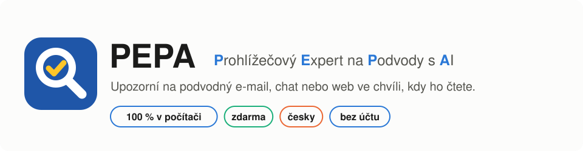
  </picture>
</p>

<p align="center">
  <b>Rozšíření prohlížeče, které čte s vámi a včas řekne: „Pozor, tohle je podvod. A tady je proč.“</b><br>
  Vlastní česká umělá inteligence běží přímo ve vašem počítači. Nic neodesílá, nic nestojí, nepotřebuje účet.
</p>

<p align="center">
  <a href="LICENSE"></a>
  
  
  
</p>

<p align="center">
  PEPA vznikl pro <a href="https://mesic.ai"><b>AI výzvu pro Česko 2026</b></a> České asociace umělé inteligence, v oblasti <b>Prevence podvodů</b>.
</p>

<p align="center">
  <a href="https://youtu.be/Qrwu3yyMR3c"></a>
</p>

<p align="center">
  <a href="#proč-pepa">Proč</a> ·
  <a href="#jak-to-vypadá">Ukázky</a> ·
  <a href="#instalace">Instalace</a> ·
  <a href="#vyzkoušejte-si-hrajte-si-na-podvodníka">Vyzkoušejte si</a> ·
  <a href="#jak-to-funguje">Jak to funguje</a> ·
  <a href="#jak-jsme-pepu-trénovali">Trénování</a> ·
  <a href="#výsledky">Výsledky</a> ·
  <a href="#soukromí">Soukromí</a>
</p>

<p align="center">
  <picture>
    <source media="(prefers-color-scheme: dark)" srcset="docs/media/stats-dark.svg">
    
  </picture>
</p>

## Proč PEPA

Podvodů s pomocí AI se podle Českého barometru obav z AI 2026 bojí 77,5 % lidí, nejvíc ze všech sledovaných
obav. S AI zní podvodná zpráva jako od skutečné banky, kurýra, úřadu nebo vnuka. Poznat to je nejtěžší
pro seniory, a podvodníci na ně často cílí.

**Nejnebezpečnější podvod je ten, u kterého vás nic nenapadne.** Proto PEPA průběžně čte vše, co se
v prohlížeči objeví (e-maily, chaty jako WhatsApp Web, zprávy na bazarech, inzeráty, reklamy i text v obrázcích),
a ozve se sám, i když vás nic nenapadlo.

PEPA proto:

- 🛡️ **hlídá sám:** každou zprávu zkontroluje ve chvíli, kdy se objeví na obrazovce;
- 💬 **vysvětlí lidsky:** jednou větou řekne, co je podezřelé, a poradí další krok;
- 🔒 **nic neprozradí:** oba modely běží ve vašem počítači, text zpráv nikdy neopustí počítač a neukládá se;
- 💸 **je zdarma:** žádné předplatné, žádné placené API, žádný účet, žádný server, který by někdo musel platit;
- 🤫 **neplaší zbytečně:** když text nestačí k rozhodnutí, mlčí; na testu varoval zbytečně zhruba u 3 ze 100
  běžných textů a u žádné z 32 skutečných běžných zpráv.

Hlídat všechno, co člověk čte, jde jen s malými místními modely: velký model v cloudu by stál peníze za každou
zprávu a viděl by všechno, co v prohlížeči čtete: poštu, chaty, bankovnictví i sociální sítě. Proto jsme vlastní modely dotrénovali tak, aby stačil běžný notebook.

PEPA je druhý pár očí, ne záruka. Upozorní na 9 z 10 podvodů, ale nějaký přehlédnout může, a občas se ozve
i u běžné zprávy. Rozhodnutí vždy zůstává na vás.

## Jak to vypadá

🟡 **Za necelou sekundu** se podezřelá zpráva orámuje: „Možný podvod · ověřuji“.<br>
🔴 **Asi za 2 sekundy** jazykový model rozhodne. Oranžová znamená možný podvod, červená téměř jistý podvod.
Když se rychlý model spletl, rámeček zmizí.<br>
💡 **Pak** model dopíše, co přesně je na zprávě podezřelé, a poradí, co dělat. Po kliknutí se ukáže celé vysvětlení.

### Podvodný e-mail z „bezpečnostního oddělení banky“ v Gmailu


### „Mami, mám nové číslo“ na WhatsApp Web


### Nebezpečná příloha v Gmailu


### Běžný e-mail na Seznamu: PEPA mlčí

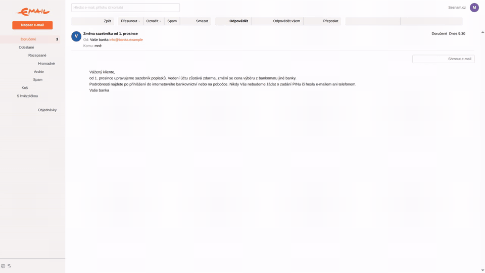

Záznamy jsou skutečné běhy PEPY na věrných, anonymizovaných kopiích Gmailu, Seznamu a WhatsApp Web s vymyšlenými
zprávami. Čekání na dopsání vysvětlení je zrychlené a v animaci označené („zrychleno“), zbytek běží v reálném čase.

## Instalace

PEPA běží na Windows 10/11, Linuxu a macOS (Apple Silicon) v prohlížečích Chrome, Edge, Brave, Chromium a
Vivaldi (verze 116+). Instalaci za seniora zvládne vnuk nebo dobrovolník za pár minut, pak už není potřeba nic
nastavovat. Práva správce nejsou potřeba. Stáhne se asi 2,5 GB (modely 1,7 GB, zbytek Python a llama.cpp).

1. Stáhněte repozitář: **Code → Download ZIP** a rozbalte ho, nebo `git clone https://github.com/chlebja3/pepa`.
2. Spusťte instalátor:
    - **Windows:** ve složce `install` dvakrát klikněte na `install.cmd`.
    - **Linux a macOS:** v terminálu spusťte `./install/install.sh`.

    Instalátor si sám stáhne [uv](https://docs.astral.sh/uv/) a Python, modely a sestavení llama.cpp pro váš
    systém (modely z [Hugging Face](https://huggingface.co/chlebajz/pepa)), u všeho ověří kontrolní součet a pomocníka zaregistruje ve všech nalezených prohlížečích. Přerušenou
    instalaci stačí spustit znovu. Kromě registrace v prohlížečích se vše ukládá jen do složky PEPA.

3. V prohlížeči otevřete `chrome://extensions` (Edge: `edge://extensions`), zapněte **Režim pro vývojáře**,
    klikněte na **Načíst rozbalené** a vyberte složku `extension`. Restartujte prohlížeč.
    PEPA hlídá jen v prohlížeči, do kterého rozšíření takto načtete. Registrace v ostatních prohlížečích je jen
    malý soubor, který sám nic nedělá.

**Odinstalace:** spusťte `install\install.cmd --uninstall` (Windows) nebo `./install/install.sh --uninstall`
(Linux, macOS), na stránce rozšíření PEPU odeberte a smažte celou složku PEPA. Tím je z počítače pryč všechno.

<details>
<summary><b>Podrobnosti: OCR, pomocník, procesor a grafická karta</b></summary>

<br>

Text v obrázcích (OCR) potřebuje knihovnu Tesseract: na Linuxu `sudo apt install libtesseract5`, na macOS
`brew install tesseract`, na Windows [instalátor UB Mannheim](https://github.com/UB-Mannheim/tesseract/wiki).
Bez ní PEPA funguje, jen obrázky přeskakuje.

Prohlížeč pomocníka spustí při připojení rozšíření a ukončí ho při svém zavření. Komunikace jde přes Native
Messaging, takže se neotevírá žádný síťový port. Jeden proces obslouží všechna okna a karty.

`helper/backend.py` vybere výpočetní zařízení. Vyhrazená grafická karta (NVIDIA, Radeon RX/Pro, Intel Arc) s aspoň
1,7 GB volné paměti počítá přes Vulkan, Mac s Apple Silicon přes Metal. Jinak pomocník počítá na procesoru,
jedno vlákno na fyzické jádro. Integrované grafiky v PC přeskakuje, protože jsou pomalejší než jádra. Když
grafickou kartu potřebujete na něco jiného, proměnná prostředí `PEPA_CPU=1` vynutí výpočet na procesoru. Na Linuxu
funguje i v sandboxu snapového Chromia (výchozí na Ubuntu).

</details>

## Vyzkoušejte si: hrajte si na podvodníka

Na skutečné podvodné stránky chodit nemusíte. Spusťte ukázky (**Windows:** dvakrát klikněte na
`examples\spustit.cmd`, **Linux a macOS:** `./examples/spustit.sh`) a v prohlížeči s PEPA otevřete
http://127.0.0.1:8000.

- **Hrajte si na podvodníka.** Vyberte chat, e-mail, bazar nebo sociální síť a napište oběti zprávu vlastními
  slovy: vnuk v nouzi, „ověření účtu“, kupec s kurýrem, zázračná investice… Zpráva se objeví na obrazovce oběti
  a PEPA ji během pár sekund posoudí, stejně jako ve skutečné aplikaci. Napište i běžnou zprávu a uvidíte, že PEPA
  mlčí. Kdo nechce psát, přehraje jedním klikem připravený podvod nebo běžnou konverzaci.
- **Skutečné zprávy.** 10 skutečných podvodů a 3 skutečné běžné zprávy, jak je zveřejnily zpravodajské weby
  a hoax.cz, každá s odkazem na zdroj.

Všechna jména, čísla a odkazy v ukázkách jsou vymyšlené a nikam nevedou. Libovolný text zkontrolujete i bez
prohlížeče: `helper/.venv/bin/python helper/check.py "text zprávy"`.

## Jak to funguje

<picture>
  <source media="(prefers-color-scheme: dark)" srcset="docs/media/pipeline-dark.svg">
  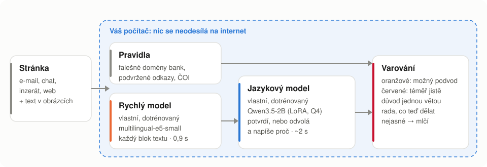
</picture>

1. **Rozšíření přečte, co vidíte:** viditelné bloky textu webu, webmailu nebo chatu (třeba WhatsApp Web). Text
   v obrázcích přečte místní OCR (Tesseract). Nové zprávy kontroluje hned, jak přibudou.
2. **Rychlá pravidla** hledají to, co jde poznat jistě: falešné domény bank, odkaz, který vede jinam, než
   ukazuje, domény z podobných znaků jiných abeced, přihlašovací formulář na cizí doméně, e-shopy ze seznamu ČOI,
   nebezpečné typy příloh (třeba „faktura.pdf.html“) a adresy, kam vedou QR kódy v obrázcích.
3. **Rychlý model** (náš dotrénovaný multilingual-e5-small) projde každý blok textu za zlomek sekundy. Je
   nastavený tak, aby podvod raději nepřehlédl. Rozhoduje jen o tom, co si přečte jazykový model.
4. **Jazykový model** (náš dotrénovaný Qwen3.5-2B) podezření potvrdí, nebo odvolá. U podvodu napíše jednou
   větou proč. Když je zpráva příliš krátká nebo nejasná, odpoví „nevím“. Rozšíření pak zprávu posoudí ještě
   jednou i s okolními zprávami konverzace; když nestačí ani ty, nic se neukáže.
5. **Varování** se ukáže hned po rozhodnutí. Jazykový model pak dopíše důvod a radu, co dělat; když radu
   nenapíše, použije se pevně daná rada pro daný typ podvodu (banka, zásilka, investice, příbuzný v nouzi,
   bazar, vzdálený přístup a další). Kliknutí na podezřelý odkaz rozšíření zastaví a nejdřív se zeptá.

Modely běží v **pomocníkovi**: místním procesu s llama.cpp, který prohlížeč sám spouští a ukončuje.

Dvoustupňové řešení šetří čas: rychlý model pošle k jazykovému zhruba čtvrtinu běžných textů, ale všechny
podvody. Pomalejší, ale chytřejší jazykový model pak naprostou většinu falešných podezření odvolá.

<picture>
  <source media="(prefers-color-scheme: dark)" srcset="docs/media/funnel-dark.svg">
  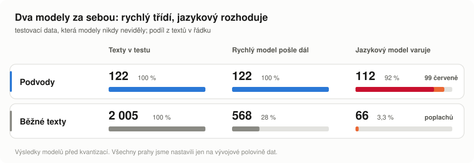
</picture>

## Jak jsme PEPU trénovali

Hotový jazykový model podvody v češtině sice pozná, ale plaší skoro u každé třetí běžné zprávy. Proto jsme oba
modely dotrénovali na vlastních českých datech. Skripty, kterými vznikly nasazené modely, i všechna nastavení
trénování jsou ve složce [`training`](training) (začněte souborem [`pipeline.sh`](training/pipeline.sh)).
Trénovací data nezveřejňujeme. Tady je, jak vznikla a co fungovalo.

### Data

<picture>
  <source media="(prefers-color-scheme: dark)" srcset="docs/media/data-dark.svg">
  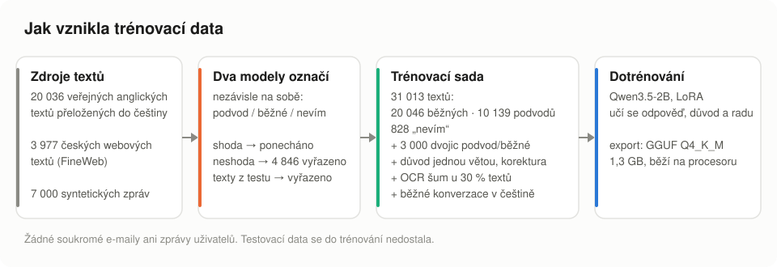
</picture>

- **Zdroje.** Veřejné anglické sady (phishingové a podvodné e-maily, spam, SMS, přepisy podvodných hovorů)
  přeložené do češtiny jazykovým modelem, běžné české texty z webu (FineWeb) a syntetické české zprávy
  napsané podle typů podvodů, které v Česku skutečně kolují: falešná banka, zásilka, investice, „mami, mám
  nové číslo“, bazar, vzdálený přístup a další.

  <details>
  <summary>Použité veřejné sady (Hugging Face)</summary>

  | Sada | Obsah |
  |---|---|
  | [zefang-liu/phishing-email-dataset](https://huggingface.co/datasets/zefang-liu/phishing-email-dataset) | phishingové a běžné e-maily |
  | [cybersectony/PhishingEmailDetectionv2.0](https://huggingface.co/datasets/cybersectony/PhishingEmailDetectionv2.0) | phishingové a běžné e-maily |
  | [SetFit/enron_spam](https://huggingface.co/datasets/SetFit/enron_spam) | spam a běžná firemní pošta |
  | [Deysi/spam-detection-dataset](https://huggingface.co/datasets/Deysi/spam-detection-dataset) | spam a běžné zprávy |
  | [mshenoda/spam-messages](https://huggingface.co/datasets/mshenoda/spam-messages) | krátké spamové a běžné zprávy |
  | [ucirvine/sms_spam](https://huggingface.co/datasets/ucirvine/sms_spam) | krátké spamové a běžné zprávy |
  | [BothBosu/scam-dialogue](https://huggingface.co/datasets/BothBosu/scam-dialogue) | přepisy podvodných a běžných hovorů |
  | [BothBosu/multi-agent-scam-conversation](https://huggingface.co/datasets/BothBosu/multi-agent-scam-conversation) | přepisy podvodných a běžných hovorů |
  | [HuggingFaceFW/fineweb-2](https://huggingface.co/datasets/HuggingFaceFW/fineweb-2) (čeština) | běžné české texty z webu |

  Z každé sady jsme vzali jen vzorek, cizojazyčné texty přeložili a znovu označili postupem popsaným níže.
  </details>

- **Štítky naslepo.** Každý text označily dva různé jazykové modely, aniž by znaly zamýšlený štítek: podvod,
  běžný, nebo „nevím“, když text nestačí. Ponechali jsme jen texty, kde se shodly; 4 846 sporných jsme vyřadili.
- **Vysvětlení a rady.** U každého textu je jedna věta „proč“ a u podvodů i rada, co dělat. Jazykový model se
  je učí psát. Všechny věty prošly jazykovou korekturou.
- **Dvojice podvod a běžná zpráva.** 3 000 syntetických zpráv ve dvojicích se stejnou žádostí (přihlásit se,
  zaplatit, poslat kód, otevřít přílohu), jednou v běžné situaci a jednou v podvodné. Model se tak učí soudit
  podle souvislostí (kdo žádá, jakou cestou, kam vede odkaz), ne podle tématu nebo značky.
- **„Ahoj mami, mám nové číslo.“** Tyto úvodní zprávy samy nic nežádají, ale skoro vždy začínají podvod. Proto
  je v datech označujeme jako podvod, ne „nevím“.
- **Odolnost vůči OCR.** U 30 % textů jsme simulovali chyby čtení z obrázků: chybějící diakritiku, vypadlá
  písmena, záměny podobných znaků.
- **Čistý test.** Testovací data jsme oddělili předem a texty, které se jim podobají, jsme z trénování vyřadili.
  Žádné soukromé e-maily ani zprávy uživatelů v datech nejsou.

### Jazykový model

Qwen3.5-2B jsme dotrénovali metodou LoRA (rank 16, dvě epochy). Chyba se počítá jen z odpovědi (verdikt, důvod
a rada), ne z textu zprávy. Mezi příklady je 15 % běžných konverzací, aby model nezapomněl obecnou češtinu. Model
jsme pak kvantizovali do GGUF Q4_K_M (1,3 GB), aby běžel na procesoru.

<picture>
  <source media="(prefers-color-scheme: dark)" srcset="docs/media/training-dark.svg">
  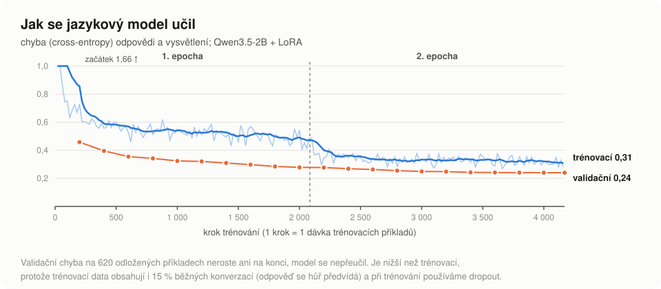
</picture>

Důležitá je validační chyba na odložených příkladech, která do konce trénování nevzrostla.

Dotrénování udělalo z obecného modelu spolehlivého hlídače. Původní Qwen3.5-2B varuje skoro u všeho, i u 589
z 2005 běžných textů (u každého třetího), takže jeho varování nic neznamená. Když oba modely nastavíme tak, aby
planě varovaly jen u 1 % běžných textů, původní najde 33 % podvodů a dotrénovaný 75 %.

<picture>
  <source media="(prefers-color-scheme: dark)" srcset="docs/media/finetune-dark.svg">
  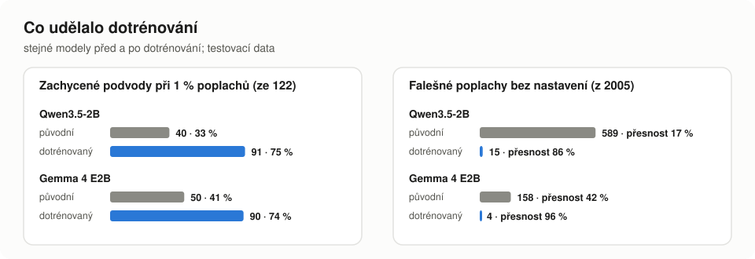
</picture>

### Které varianty jsme zkoušeli

Dotrénovali jsme 22 variant dvou malých modelů, **Qwen3.5-2B** a **Gemma 4 E2B**: různá velikost adaptéru a délka
trénování, s chybami z OCR i bez nich, s opakováním podvodů, bez strojově přeložených sad, s korekturou
vysvětlení, krátkými útržky a dvojicemi podvod a běžná zpráva. Všechny jsme porovnali tak, jak PEPA skutečně
běží: práh jsme nastavili na vývojových datech na záchyt 90 % podvodů a na testovacích datech spočítali
falešné poplachy.

<picture>
  <source media="(prefers-color-scheme: dark)" srcset="docs/media/variants-dark.svg">
  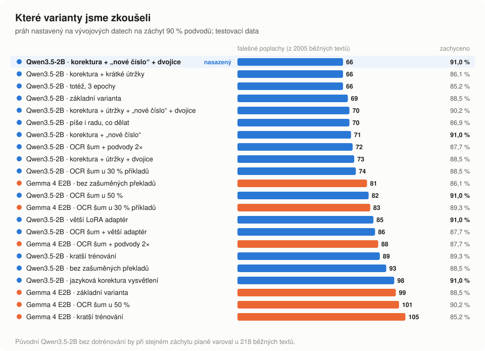
</picture>

- **Proč Qwen s korekturou a dvojicemi:** při stejném záchytu má nejméně falešných poplachů a zároveň zachytí
  nejvíc testovacích podvodů (91 %). Ze šesti nejlepších variant zachytil nejvíc skutečných podvodů. Qwen je navíc
  na procesoru rychlejší než Gemma.
- **Co nevyšlo:** dotrénování všech vah místo LoRA bylo výrazně pomalejší a nedokončili jsme ho. Víc šumu z OCR
  (50 % příkladů) ani větší adaptér nepomohly.
- **Bez dotrénování to nejde:** původní Qwen3.5-2B by při stejném záchytu planě varoval u 218 z 2005 běžných textů.

### Rychlý model

Rychlý model je multilingual-e5-small se třemi třídami (podvod, běžné, nevím), dotrénovaný na 46 338 textech:
data jazykového modelu, běžné i podvodné e-maily, weby a SMS, krátké útržky a dvojice podvod a běžná zpráva. Jeho
práh jsme nastavili tak, aby na vývojových datech propustil k jazykovému modelu aspoň 97 % podvodů. Jeden text
zpracuje za 15–20 ms.

<details>
<summary><b>Porovnání variant rychlého modelu</b></summary>

<br>

Aby šly varianty porovnat, mají v tabulce všechny stejný, přísnější práh: na vývojových datech propustí 95 %
podvodů. Nasazený práh je volnější (97 %), čísla s ním jsou pod tabulkou.

| Varianta | Podvody poslané dál (ze 122) | Běžné texty poslané dál (z 2005) |
| --- | --- | --- |
| e5-small, podvody 3× | 99,2 % | 230 |
| e5-small, podvody 3× + OCR šum | 97,5 % | 251 |
| e5-small, podvody 5× | 95,1 % | 213 |
| e5-small + syntetické e-maily | 99,2 % | 389 |
| e5-small + e-maily a weby | 95,9 % | 450 |
| **e5-small + e-maily, weby, útržky a dvojice (nasazený)** | **93,4 %** | **228** |
| e5-base, podvody 3× | 94,3 % | 178 |
| mmBERT, podvody 3× + OCR šum | 98,4 % | 318 |
| mmBERT-base, podvody 3× | 97,5 % | 430 |

Varianty nahoře vypadají v tabulce lépe jen proto, že testovací data skoro neobsahují běžné e-maily a weby.
Varianty bez nich v trénování v praxi předběžně
označovaly mnoho legitimních e-mailů. Jazykový model to sice odvolal, ale uživatel viděl zbytečný rámeček a
počítač sekundy počítal. Nasazená varianta je proto má v trénování. S nasazeným prahem (97 % na vývojových
datech) pošle dál všech 122 testovacích podvodů a 568 běžných textů (28 %). Ze zvlášť odložených syntetických běžných
e-mailů pošle dál 4,8 % a rámeček „ověřuji“ neukáže u žádného.

</details>

## Výsledky

<picture>
  <source media="(prefers-color-scheme: dark)" srcset="docs/media/accuracy-dark.svg">
  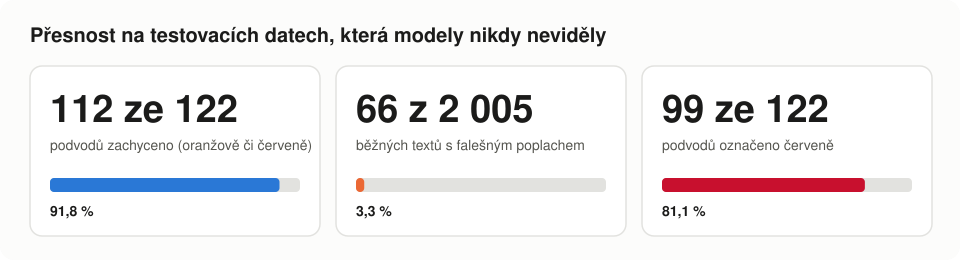
</picture>

Měřeno oběma modely za sebou na testovací polovině dat, kterou modely neviděly při trénování ani při volbě
prahů (modely před kvantizací; nasazené kvantizované modely jsme ověřili na skutečných podvodech níže). Mezi
běžnými texty je 1916 textů z českého webu, takže podvodů je jen 6 %, podobně jako ve skutečné poště.
Citlivost je nastavená tak, aby PEPA upozornil aspoň na 9 z 10 podvodů. Platí za to zbytečným varováním zhruba
u 3 ze 100 běžných textů, červeným jen u 1,9 %. Přehlédnutý podvod je horší než zbytečné upozornění, ale
příliš častý poplach by lidi naučil varování přehlížet. Všech 30 testovacích stránek ([`tests/pages`](tests/pages):
vymyšlené podvody a legitimní stránky, které se jim podobají) se chová podle očekávání na procesoru i na
grafické kartě.

Model nemusí jen říct ano, nebo ne. Jeho jistota rozhoduje o barvě: oranžová znamená možný podvod, červená
téměř jistý. Většina běžných textů leží daleko vlevo, většina podvodů daleko vpravo.

<picture>
  <source media="(prefers-color-scheme: dark)" srcset="docs/media/margins-dark.svg">
  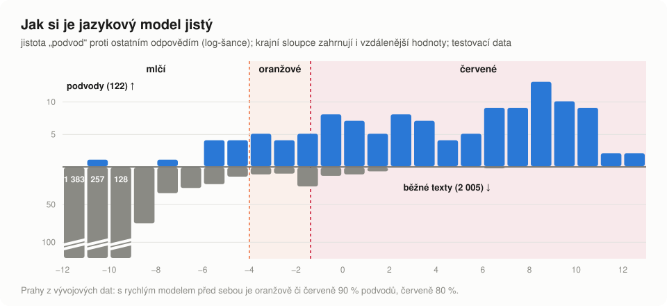
</picture>

### Skutečné podvody

Testovací data jsou z velké části syntetická. Proto jsme PEPU, přesně v té podobě, v jaké si ji nainstalujete, vyzkoušeli i na
116 skutečných českých podvodných zprávách, které zveřejnily hoax.cz, Policie ČR a zpravodajské weby, a na
32 skutečných běžných textech. Až na pár krátkých obecných vět tyto texty v trénovacích datech nebyly.

<picture>
  <source media="(prefers-color-scheme: dark)" srcset="docs/media/realworld-dark.svg">
  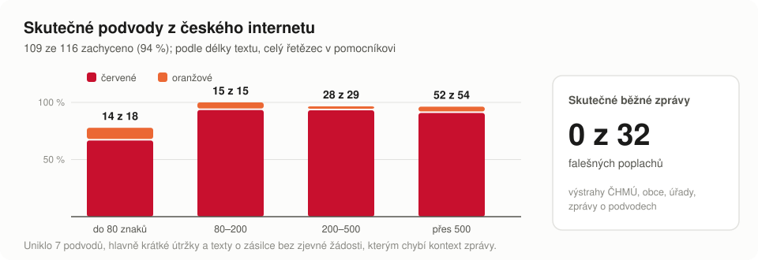
</picture>

PEPA zachytil 109 ze 116 podvodů (94 %), z toho 102 červeně, a u žádné běžné zprávy nevaroval. Prahy jsme
na těchto datech nenastavovali. Uniklo 7 podvodů: čtyři krátké útržky (třeba „Je vám poskytnut příspěvek na
bydlení po dobu 3 měsíců od Mpsv“) a tři delší oznámení o zásilce nebo vyúčtování, která nic zjevně nežádají.
U nich samotný text nestačí a PEPA podle pravidla „když neví, mlčí“ nevaruje.

Tyto zprávy si můžete sami otevřít v prohlížeči, viz [Vyzkoušejte si](#vyzkoušejte-si-hrajte-si-na-podvodníka).

### Rychlost

<picture>
  <source media="(prefers-color-scheme: dark)" srcset="docs/media/speed-dark.svg">
  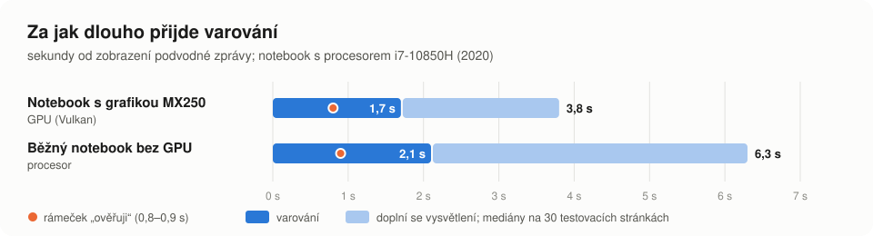
</picture>

| Výpočet | Připraven po spuštění | Rozhodnutí | Varování na stránce | Doplněný důvod | Paměť |
| --- | --- | --- | --- | --- | --- |
| Procesor | 8,4 s | 1,9 s | 2,1 s | 6,3 s | 2,1 GB RAM |
| GeForce MX250 (Vulkan) | 9,4 s | 1,4 s | 1,7 s | 3,8 s | 1,4 GB grafické paměti |

Notebook Dell s procesorem i7-10850H (6 jader), grafikou Intel UHD a GeForce MX250 (2 GB). Rozhodnutí: medián
na 71 skutečných textech (typicky 500 znaků); varování a důvod: mediány na 30 testovacích stránkách v Chromiu.
Rozhodnutí stojí na jediném tokenu. PEPA ukáže varování hned a důvod s radou model dopíše až potom; na procesoru
tak varování přijde zhruba 2,5× dřív. Rámeček „ověřuji“ se ukáže za 0,8–0,9 s, i když rychlý model
potřebuje jen 15–20 ms: rozšíření nejdřív počká 0,6 s, až se stránka přestane měnit (načítání, psaní
zprávy), aby nečetlo napůl vykreslený text. Kontrolní bod po systémovém promptu ušetří jeho opakované čtení.

## Co jsme vytvořili

Celé řešení je naše a běží u uživatele:

- **Ochrana i bez podezření.** PEPA průběžně kontroluje vše, co se v prohlížeči zobrazí, takže pomůže i tam,
  kde uživatele nic nenapadne.
- **Vlastní česká data o podvodech** se štítky naslepo od dvou modelů, vysvětlením u každého textu a
  dvojicemi podvod a běžná zpráva. Trénovací skripty jsou veřejné.
- **Dva vlastní dotrénované modely:** rychlý model nastavený tak, aby podvod raději nepřehlédl, a jazykový model s třídou „nevím“,
  odolný vůči šumu z OCR. Prahy jsme volili jen na vývojových datech.
- **Rychlost na slabém hardwaru:** kvantizace, rozhodnutí z jednoho tokenu, varování dřív než vysvětlení a
  automatická volba procesoru, nebo vyhrazené grafické karty.
- **Rozhraní pro seniory.** Dvě barvy varování, věta „proč“, konkrétní rada, jak postupovat, zastavení
  podezřelých odkazů a velké čitelné písmo (Atkinson Hyperlegible). Klidná stránka se nikdy neprohlašuje za
  „bezpečnou“.
- **Pravidla bez výjimek pro konkrétní firmy.** Obecné kontroly odkazů, domén a formulářů a datovaný snímek
  seznamu rizikových e-shopů ČOI. Přílohy se posuzují jen podle typu souboru, QR kódy jako odkazy.
- **Instalátor** pro tři systémy a pět prohlížečů, s ověřením kontrolních součtů.
- **Testy.** Jednotkové testy a test celého rozšíření v Chromiu na 30 stránkách.

## Soukromí

- Rozšíření předává jen text, který je na stránce vidět (skrytý text, kterým by podvodník mohl zprávu
  „naředit“, vynechá), doménu stránky, domény odkazů, vybraná
  metadata přihlašovacích formulářů a výřezy viditelných obrázků. Dostane je jen místní pomocník.
- Nečte cookies, hodnoty formulářů ani to, co píšete. Pole pro psaní a upravitelné oblasti přeskakuje.
- Nic se neukládá na disk a nic se nezaznamenává. Žádná telemetrie, žádný účet, žádný záložní cloud.
- Modely se načítají v offline režimu Hugging Face: pomocník se po instalaci nikam nepřipojuje.
- Úložiště rozšíření drží jen vypínač a nastavení pro jednotlivé weby.
- Rozšíření žádá přístup ke všem stránkám, protože podvod může přijít kdekoli. Obsah ale předává jen místnímu
  pomocníkovi (Native Messaging), ne na internet. Hlídání lze pro jednotlivé weby vypnout.

## Omezení

- Zatím hlídá jen to, co čtete v prohlížeči. Jiné aplikace v počítači, SMS v telefonu a telefonáty nepokrývá.
- Podvod může přehlédnout, hlavně když vypadá přesně jako běžná zpráva. Podvod, který se rozbíhá nevinným
  pozdravem, pozná až ve chvíli, kdy přijde žádost o peníze, údaje nebo kliknutí.
  Když neví, raději mlčí, než aby hádal.
- Zhruba u 3 ze 100 běžných textů varuje zbytečně, většinou oranžově.
- Varování je rada, ne důkaz. Nepřátelská stránka by mohla panel napodobit nebo skrýt; platby se neblokují.
- Testovací data jsou z velké části syntetická a sada skutečných běžných textů je zatím malá.
- Nejvíc testováno na Chromiu v Linuxu. Čtení textu zatím nebylo ověřeno na všech webmailech a chatech.
- Rozšíření se zatím načítá ručně v režimu pro vývojáře; Firefox zatím nepodporujeme.

## Kam dál

- **Celý počítač:** hlídat i poštovní programy, chatovací aplikace a vše ostatní, co je na obrazovce.
- **Mobil:** stejná místní ochrana v telefonu, včetně SMS a zpráv v aplikacích.
- **Snazší instalace:** rozšíření z Internetového obchodu Chrome, instalátor s ikonou a podpora Firefoxu.
- **Lepší data:** víc skutečných podvodů i běžných zpráv, hlavně krátkých, kde PEPA zatím chybuje nejvíc.
- **Odesílatel v souvislostech:** posuzovat hlavičku e-mailu (kdo píše a z jaké adresy) spolu s textem zprávy. Dnes PEPA kontroluje jen text zprávy; samotný řádek s odesílatelem je na posouzení příliš krátký.

<details>
<summary><b>Struktura repozitáře</b></summary>

<br>

```text
pepa/
├── install/      instalátor: install.cmd (Windows), install.sh (Linux, macOS), install.py,
│                 MODELS.md a MODELS.sha256 (odkud se stahují modely a jejich kontrolní součty)
├── extension/    rozšíření prohlížeče: čtení stránky, rámečky a panel s vysvětlením
├── helper/       pomocník, který běží v počítači:
│   ├── native_host.py      spojení s prohlížečem (Native Messaging)
│   ├── screener.py         rychlý model (multilingual-e5-small)
│   ├── verifier.py         jazykový model (Qwen3.5-2B přes llama.cpp)
│   ├── backend.py          volba procesor / grafická karta
│   ├── link_signals.py, page_signals.py, text_signals.py, categories.py, ocr.py
│   │                       pravidla, texty rad, OCR
│   ├── check.py            kontrola libovolného textu z příkazové řádky
│   └── data/               snímek seznamu rizikových e-shopů ČOI, textové signály
│                           (instalátor sem přidá .venv/, models/ a runtime/llama.cpp/)
├── examples/     vyzkoušejte si: hra na podvodníka (podvodnik.html), skutečné podvody a běžné
│                 zprávy; spouští se přes spustit.cmd / spustit.sh
├── tests/        jednotkové testy a test rozšíření v prohlížeči
├── training/     skripty a nastavení, kterými vznikly nasazené modely (data nezveřejňujeme)
└── docs/media/   obrázky a animace pro tento popis
```

</details>

<details>
<summary><b>Testy</b></summary>

<br>

```bash
helper/.venv/bin/python -m unittest discover -s tests -p 'test_*.py'
# test celého rozšíření (potřebuje playwright a Chromium; používá dočasný profil):
helper/.venv/bin/python tests/scam_pages_e2e.py
# hra na podvodníka: připravené scénáře i nové, ručně psané zprávy
helper/.venv/bin/python tests/playground_e2e.py
```

</details>

## Licence

Náš kód a dotrénované modely jsou pod licencí [Apache 2.0](LICENSE). Komponenty třetích stran (základní
modely Qwen3.5-2B a multilingual-e5-small, llama.cpp, Tesseract, písmo Atkinson Hyperlegible a další) mají
vlastní licence; viz [THIRD_PARTY.md](THIRD_PARTY.md).
